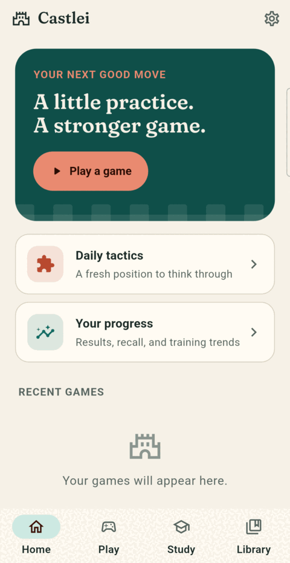
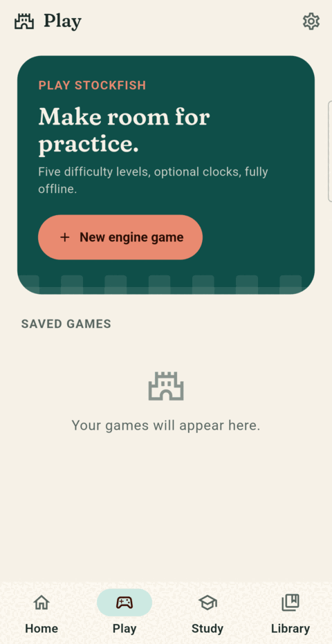
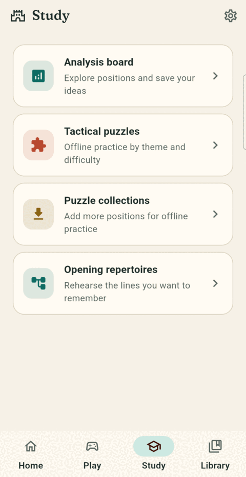
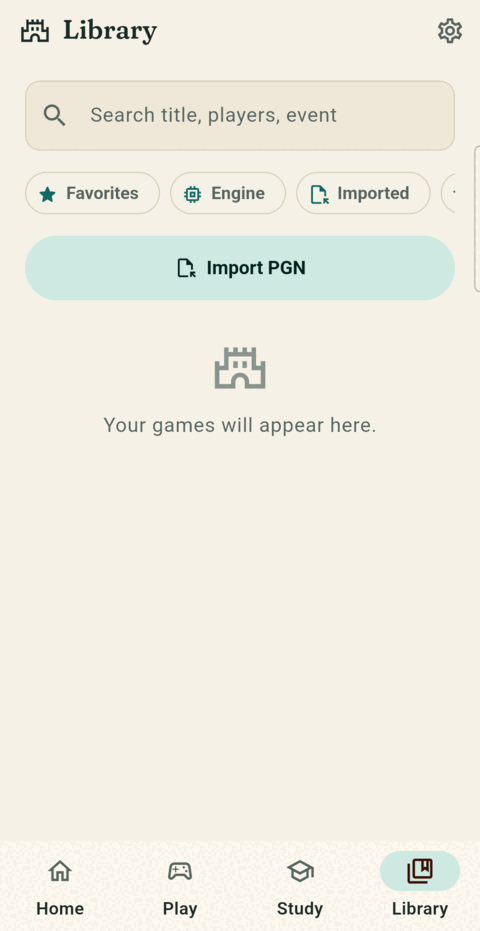
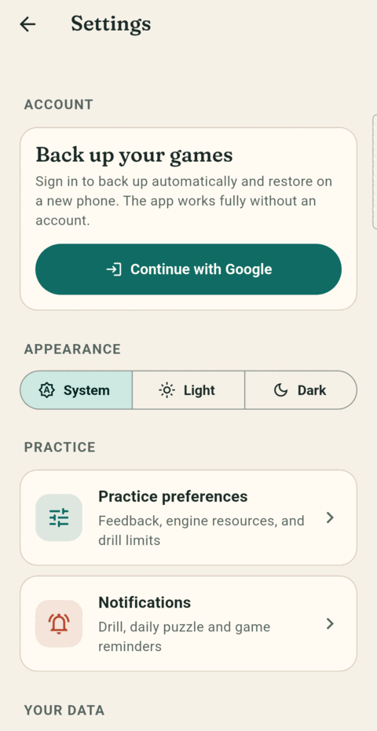

# Castlei

A private chess companion for Android (iOS prepared). Play the Stockfish engine on your phone, analyse and review games with an evaluation graph, drill tactics and openings, and keep everything on the device. An account, cloud backup, crash reports and analytics are all optional.

Website: https://castlei.andwati.com. Licensed under the GNU GPL v3.0 (see `LICENSE`); third-party notices are in the app (Settings → Open-source software) and in `NOTICE.md`.

<table>
  <tr>
    <td align="center"><picture><source media="(prefers-color-scheme: dark)" srcset="docs/screenshots/home_dark.png"></picture><br><sub>Home</sub></td>
    <td align="center"><picture><source media="(prefers-color-scheme: dark)" srcset="docs/screenshots/play_dark.png"></picture><br><sub>Play</sub></td>
    <td align="center"><picture><source media="(prefers-color-scheme: dark)" srcset="docs/screenshots/study_dark.png"></picture><br><sub>Study</sub></td>
    <td align="center"><picture><source media="(prefers-color-scheme: dark)" srcset="docs/screenshots/library_dark.png"></picture><br><sub>Library</sub></td>
    <td align="center"><picture><source media="(prefers-color-scheme: dark)" srcset="docs/screenshots/settings_dark.png"></picture><br><sub>Settings</sub></td>
  </tr>
</table>

<sub>Screenshots follow your GitHub theme (light or dark); the app itself follows the phone's.</sub>

## Build
```
./tool/fetch_engine.sh     # pinned Stockfish source and network files, checked against SHA-256
./tool/dev_setup.sh        # placeholder Firebase files; the app builds and runs without a Firebase project
flutter pub get
flutter analyze && flutter test
flutter run
```
Full instructions, including how to use your own Firebase project, are in [docs/BUILDING.md](docs/BUILDING.md). Toolchain pins: `docs/TOOLCHAIN.md`.

## Contributing
Bug reports, ideas and pull requests are welcome; start with [CONTRIBUTING.md](CONTRIBUTING.md). Report security problems privately as described in [SECURITY.md](SECURITY.md). Please follow the [Code of Conduct](CODE_OF_CONDUCT.md).

## Docs
`docs/ARCHITECTURE.md` (modules), `docs/DESIGN.md`, `docs/PRIVACY.md`, `docs/RELEASE.md` (maintainer's signing and release process), `docs/IOS.md`.
